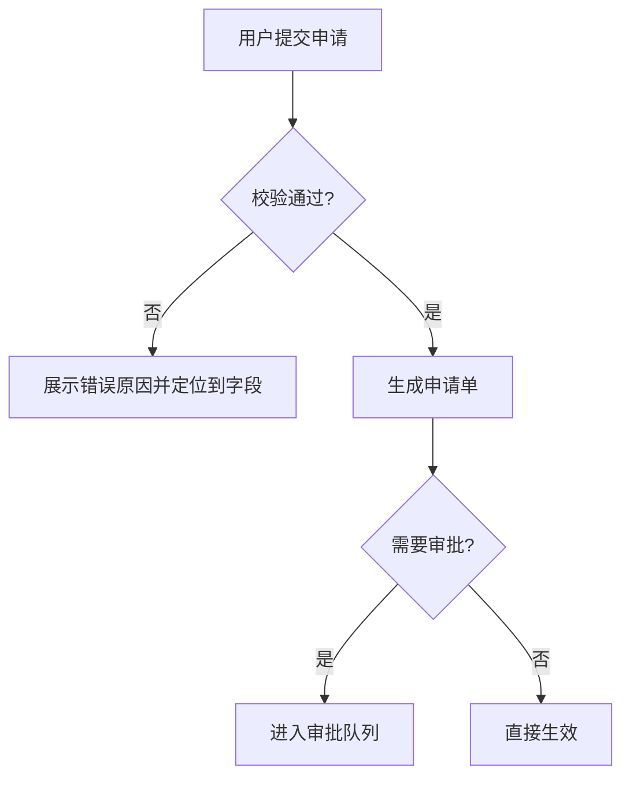

# 产品设计方法论参考

本文档为阶段 1（用户与场景分析）和阶段 2（方案设计）提供方法细节。按需加载对应章节。

## 一、用户故事地图（阶段 1）

把"我们要做什么"还原为"用户在什么情况下需要什么"。

### 拆解结构

按 **角色 → 场景 → 触点 → 痛点 → 期望** 五层拆解：

| 层 | 说明 | 示例 |
|---|------|------|
| 角色 | 谁在用（注意区分使用者与决策者） | 商家运营人员 |
| 场景 | 什么时间/情境下发生 | 每天早上盘点昨日订单异常 |
| 触点 | 通过什么入口完成 | 后台订单列表页 |
| 痛点 | 现状的阻塞或低效 | 需逐单点开核对，耗时 1 小时 |
| 期望 | 理想状态 | 一屏看出异常订单及原因 |

### 用户故事写法

`作为（角色），我想要（行为），以便（价值）。`

质量标准：
- 一条故事只含一个行为，可在 1-2 周内交付验证。
- "以便"后必须是用户价值，不是功能描述（❌以便使用筛选功能 ✅以便快速定位异常订单）。
- 覆盖低频但高影响的场景（如数据恢复、批量操作）。

### 优先级排序

推荐 MoSCoW 分级，输出本期范围表：

| 分级 | 含义 | 处理 |
|------|------|------|
| Must | 本期不做就不能上线 | 进 PRD |
| Should | 重要但可短期绕过 | 进 PRD，标注降级方案 |
| Could | 锦上添花 | 排期后续版本 |
| Won't | 本期明确不做 | 写入 Out of Scope，防止范围蔓延 |

## 二、功能架构（阶段 2）

### 分解方法

1. 一级拆分：按用户旅程或业务域切模块（如：订单管理 / 履约 / 售后）。
2. 二级拆分：每模块下列功能点，标注：优先级（Must/Should/Could）、入口（哪个页面/角色可见）、依赖（依赖哪些已有能力）。
3. 检查完整性：每个 Must 故事必须能映射到至少一个功能点；每个功能点应能追溯到至少一条故事。

## 三、核心流程图（阶段 2）

用 Mermaid flowchart 表达文字版流程，重点抓 **异常分支完整性**：

每个节点自问四件事：
1. **空态**：数据为空时展示什么？
2. **失败态**：请求失败/操作失败怎么反馈，用户如何重试？
3. **边界**：数值边界、权限边界、并发冲突（如两人同时编辑）如何处理？
4. **中断**：用户中途退出，进度是否保存？

流程图写法示例：



要求：主流程节点数控制在 5-9 个；超过时分层拆为子流程图。

## 四、页面与交互描述规范（阶段 2）

每个页面按以下模板描述（开发可直接理解，无需原型图）：

```
### 页面名称：（如：申请单列表页）
- 页面目标：一句话说明该页面帮用户完成什么
- 布局分区：自上而下/自左而右描述各区域
  - 区块1：内容 + 数据来源 + 排序规则
  - 区块2：...
- 关键元素说明：
  - 字段：展示格式、空值处理（显示什么占位）
  - 操作：按钮位置、点击后行为、不可用条件（置灰规则）
- 状态清单：加载中 / 空态 / 正常 / 出错，各状态分别展示什么
- 交互规则：输入限制、防重复提交、二次确认弹窗条件、跳转关系
```

### 交互描述易漏项检查

- 列表类：分页还是无限滚动？默认排序？筛选条件记忆吗？
- 表单类：必填标识？校验时机（即时/提交时）？失败后已填内容是否保留？
- 异步操作：是否有 loading？超时提示？结果通知方式？
- 角色差异：不同角色看到同一页面时的差异（字段/按钮/数据范围）。

## 五、方案评审对话技巧（贯穿阶段 1-2）

- 用"如果……会怎样"挑战边界：如果用户没填完就关掉页面会怎样？如果数据量到了 10 万条会怎样？
- 用"谁"校准：这个按钮是给谁用的？他现在真的会走到这一步吗？
- 警惕方案先行：用户直接给解决方案时，先还原背后的场景和痛点，再评估方案，避免把"需求"写成"指定实现"。
